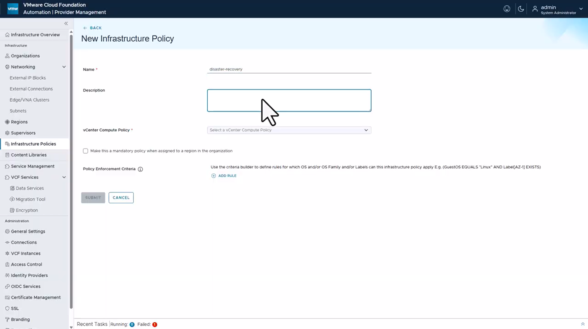

# 🏷️ VCF Automation 9.1 – Infrastructure Policies

> **New in VCF Automation 9.1** · Provider Management Feature

## Overview

**Infrastructure Policies** are a powerful new capability introduced in **VMware Cloud Foundation (VCF) Automation 9.1**. They bridge vSphere Compute Policies with VCF Automation's placement engine, enabling administrators to define intelligent, tag- and criteria-driven **workload placement rules** without requiring manual intervention at deployment time.

Think of an Infrastructure Policy as a **smart placement tag** — when a workload matches defined criteria (OS type, labels, etc.), VCF Automation automatically places it on the compute resources governed by the linked vCenter Compute Policy.

---

## 🆕 What's New in 9.1

| Capability | Description |
|---|---|
| **Infrastructure Policies** | New policy object in Provider Management for tag-based workload placement |
| **vCenter Compute Policy Binding** | Directly maps a VCF policy to a vSphere Compute Policy (e.g., HA groups, VM-Host affinity) |
| **Policy Enforcement Criteria** | Rules engine using Guest OS, OS Family, and Labels to conditionally apply policies |
| **Mandatory Policy Flag** | Option to enforce a policy as mandatory across an entire region/organisation |
| **Label-Based Targeting** | Workloads carrying specific VCF labels are automatically subject to matching policies |

---

## 🖼️ UI Reference

The screenshot below shows the **New Infrastructure Policy** form in VCF Automation Provider Management:



> **Navigation Path:**  
> `VCF Automation → Provider Management → Infrastructure → Infrastructure Policies → New`

### Form Fields

| Field | Description |
|---|---|
| **Name** | Unique identifier for the policy (e.g., `disaster-recovery`) |
| **Description** | Human-readable description of the policy's purpose |
| **vCenter Compute Policy** | The vSphere Compute Policy to enforce (e.g., VM-Host Affinity rules) |
| **Mandatory Policy** | When checked, the policy is automatically applied to all workloads in the assigned region |
| **Policy Enforcement Criteria** | Rule builder to filter which workloads the policy applies to |

---

## ⚙️ Policy Enforcement Criteria Syntax

The **Policy Enforcement Criteria** rule builder supports the following operators. Rules are combined with logical `AND`.

```
GuestOS EQUALS "<OS Name>"            # Target a specific Guest OS
GuestOSFamily EQUALS "<OS Family>"   # Target a Guest OS family (e.g., "Linux")
Label[<key>] EXISTS                   # Workload must have this label key
Label[<key>] EQUALS "<value>"         # Workload label must match a specific value
```

### Examples

```
# All Linux workloads in AZ-1
GuestOSFamily EQUALS "Linux" AND Label[AZ-1] EXISTS

# Windows workloads tagged for disaster-recovery
GuestOS EQUALS "Windows Server 2022" AND Label[disaster-recovery] EXISTS

# Any workload needing encryption compliance
Label[compliance] EXISTS AND Label[encryption-required] EXISTS
```

---

## 📄 YAML Template: `VCFA_9.1_Policies.yaml`

The `VCFA_9.1_Policies.yaml` file in this folder contains **ready-to-reference** Infrastructure Policy definitions. These are documentation-style examples that reflect the options you configure in the UI.

### Policies Included

| Policy Name | Purpose | Mandatory |
|---|---|---|
| `disaster-recovery` | Places DR-tagged workloads on HA/DRS-enabled compute | No |
| `linux-production` | Targets Linux production workloads with dedicated resources | Yes |
| `secure-encrypted` | Enforces placement on encrypted-datastore-backed compute | No |

---

## 🔄 How It Works: Workload Placement Flow

```
Deploy Request
     │
     ▼
VCF Automation evaluates active Infrastructure Policies
     │
     ├── Does the workload match Policy Enforcement Criteria?
     │        (OS Type, Labels, OS Family)
     │
     ├── YES → Apply linked vCenter Compute Policy
     │              (VM-Host Affinity, DRS Group, etc.)
     │
     └── NO  → Standard placement (no policy applied)
```

---

## 🏷️ Label-Based Targeting: Best Practices

To maximise the benefit of Infrastructure Policies, follow these labelling conventions on your VCF Automation catalog items and deployments:

- **Environment labels**: `environment=production`, `environment=dev`, `environment=dr`
- **Compliance labels**: `compliance=pci`, `compliance=hipaa`, `encryption-required=true`
- **Availability Zone labels**: `az=az-1`, `az=az-2`
- **Workload type labels**: `workload-type=gpu`, `workload-type=latency-sensitive`

These labels can be applied via:
- Cloud Template (`cloudConfig` or `tags` property)
- Catalog Service custom properties
- ABX / Orchestrator automation

---

## 📚 References

- [VCF Automation 9.1 Release Notes](https://docs.vmware.com/en/VMware-Cloud-Foundation/index.html)
- [Infrastructure Policies Documentation](https://docs.vmware.com/en/VMware-Cloud-Foundation/index.html)
- [vSphere Compute Policies](https://docs.vmware.com/en/VMware-vSphere/index.html)
